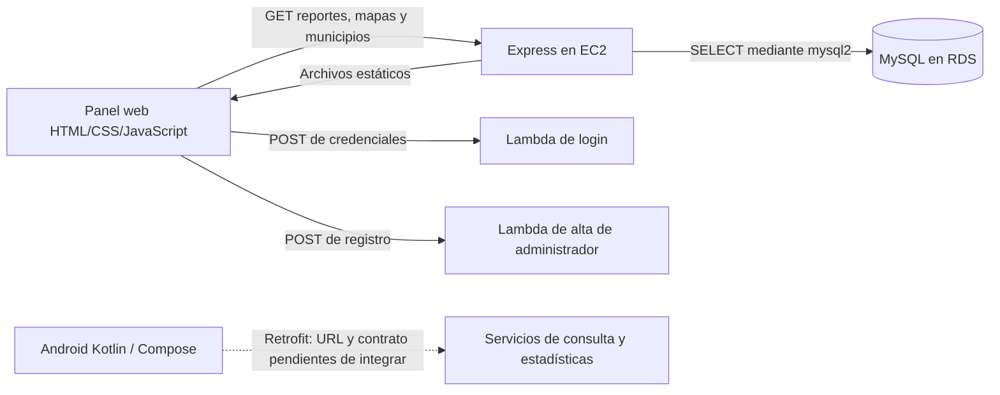

# Revisión del proyecto RIETI

Fecha: 18 de octubre de 2026. Código revisado: `debc8ae`.

## Alcance y límites

Se revisaron el backend, las páginas y controladores web, los estilos compartidos,
la cartografía, la documentación, las pruebas y el código Android incluido en
`AndroidStudio/RIETI.zip`. El ZIP se extrajo en una carpeta temporal para su lectura.
No se modificó código funcional, no se invocaron las Lambdas ni se consultó o
modificó RDS. Las pruebas usaron respuestas controladas y servidores locales.

El usuario indica que el sistema está desplegado en EC2 y que el despliegue se
realiza con GitHub. En esta copia no hay workflows, scripts de despliegue ni
configuración versionada de proxy o gestor de procesos. No se comprobó qué commit
ejecuta EC2 ni su configuración efectiva. Las observaciones siguientes describen
el código local; las condiciones actuales de AWS requieren una comprobación aparte.

## Propósito y arquitectura

RIETI busca recibir y dar seguimiento a reportes de trabajo o explotación infantil,
con una aplicación ciudadana Android y un panel web de administración y análisis.

El acceso de Express a MySQL consta en el repositorio. El código interno y las
conexiones de las Lambdas no están incluidos, por lo que no se atribuye a estas
una implementación de base de datos o autenticación que no se pudo revisar.

| Parte | Implementación y responsabilidad |
| --- | --- |
| `aplicacion_web/` | Sitio de varias páginas, sin framework ni compilación del frontend. HTML, CSS y JavaScript directos. |
| `backend/` | Node.js, Express 5, CommonJS, CORS y `mysql2/promise`. API de lectura y servidor de archivos web. |
| `AndroidStudio/RIETI.zip` | Proyecto Kotlin con Jetpack Compose, navegación, ViewModels, StateFlow y Retrofit/Gson. |
| `deploy/ec2/` | Directorio local sin archivos de configuración en esta revisión. |

## Recorrido del panel

1. `index.html` carga `app.js` para controles visuales y `login.js` para enviar
   `{user, pwrd}` a la Lambda. Si recibe una respuesta HTTP satisfactoria con
   `success`, guarda `id_admin` en `localStorage` y abre el dashboard.
2. Las pantallas de datos ejecutan `report-data.js`. Este crea `RIETI_READY`,
   consulta la API, normaliza campos y publica `RIETI_REPORTS`. Los controladores
   dependientes esperan esa promesa antes de trabajar sobre las filas o el detalle.
3. Dashboard muestra métricas generales, distribución de estados, un mapa y los
   cinco reportes más recientes. Gestión muestra la tabla, filtros y paginación
   local de diez filas. Estadísticas / Reportes amplía columnas y recalcula sus
   métricas filtradas.
4. Al abrir una fila se navega a `reporte.html?id=...&from=...`. El ID es el
   identificador interno; el folio es el texto visible. El origen se valida contra
   una lista de rutas permitidas. El detalle añade impresión, mapa y consulta de
   posibles duplicados.
5. Gráficos calcula distribuciones por estado, categoría, prioridad y municipio,
   además de tendencia temporal. Los resúmenes se abren en diálogos. La gráfica
   de tiempo de resolución está oculta mediante una constante.
6. Mapa de calor tiene un controlador modular independiente. Rendimiento muestra
   explícitamente indicadores no disponibles. Perfil conserva datos ficticios.
7. Cambiar estado, asignar autoridad y eliminar solo abren y confirman diálogos:
   no persisten cambios. Cerrar sesión confirma la navegación al login, sin
   invalidar una sesión en servidor ni retirar `id_admin`.

Los filtros se ejecutan en el navegador después de descargar todos los reportes.
Paginar y filtrar no vuelve a consultar al servidor. Actualizar recarga la página.
El CSV está habilitado en Gestión y Estadísticas / Reportes: exporta todos los
reportes cargados, incluidos los que no aparecen por filtros o paginación. El
botón de exportación de Gráficos y Rendimiento conserva un aviso provisional.

## Contrato de la API

Todas las rutas implementadas son GET; no hay operaciones de escritura en Express.

| Ruta | Respuesta o función |
| --- | --- |
| `/test` | Comprobación básica del proceso. |
| `/test-db` | Comprueba variables requeridas y ejecuta `SELECT 1`. |
| `/api/reportes` | `{data: [...]}` con reportes activos, más recientes primero. |
| `/api/reportes/:id` | `{data: {...}}`; ID numérico positivo, 400 si es inválido y 404 si falta o está inactivo. |
| `/api/reportes/:id/coincidencias` | `{data: [...]}` con hasta cinco candidatos únicos y sus motivos. |
| `/api/mapa-calor` | `{data: {municipios, puntos}}`; conserva las parejas originales de coordenadas de cada ubicación. |
| `/api/municipios` | Arreglo directo de `id_municipio`, `nombre` y `clave_corta`, ordenado por nombre. |

Las consultas de reportes usan parámetros para los identificadores. Las
relaciones de demografía y ubicación se cargan por separado para no multiplicar
las filas del listado. El backend no consulta contraseñas en estas rutas.

La selección de la URL de API está repetida en cinco controladores: una
configuración explícita `window.RIETI_API_BASE` tiene prioridad; en desarrollo
local, fuera del puerto 3000, se usa `http://127.0.0.1:3000`; en otros casos se
usa el mismo origen de la página. Login y registro mantienen URLs de Lambda
escritas directamente en sus archivos.

## Modelo de datos observado

Las relaciones siguientes se deducen de las consultas, sin haber inspeccionado
el esquema actual de RDS durante esta revisión.

| Tabla | Uso |
| --- | --- |
| `Reporte` | ID, folio, estado, prioridad, fecha, descripción, imagen, referencias y bandera `active`. |
| `Ciudadano` | Denunciante asociado mediante `id_usuario`; se recuperan nombre, correo y teléfono. |
| `Municipio` | Municipio del reporte y catálogos. Se utilizan tanto `clave` como `clave_corta`. |
| `Administrador` | Administrador asociado mediante `id_administrador`; no equivale a autoridad asignada. |
| `Demografico_Reporte` | Registros múltiples con cantidad de niños, edades y tipo de trabajo. |
| `Ubicacion_Reporte` | Registros múltiples con dirección, latitud y longitud. |
| `Procurador` | Autoridad prevista en los acuerdos; todavía sin rutas de consulta/asignación en Express. |
| `Reporte_Historial` | Estructura documentada para cambios futuros; todavía no se lee ni escribe desde Express. |

Listado, detalle, coincidencias y mapas restringen los reportes a `active = 1`.
No hay consulta ni restauración de bajas. `id_reporte` identifica las operaciones;
`folio` se muestra sin fabricar valores cuando falta.

Los valores múltiples de demografía y ubicación se deduplican por campo y se unen
con ` · `. No se suman cantidades de niños. En particular, latitudes y longitudes
se aplanan por separado en la API de reportes: el mapa del detalle solo funciona
si ambos campos resultantes son números individuales. El mapa general usa la
ruta específica que conserva cada pareja de coordenadas.

Los ocho estados definidos en el frontend son `Registrado`, `En_revision`,
`En_seguimiento`, `Canalizado`, `Concluido`, `Archivado`, `Cancelado` y `Reincidente`.
Registrados cuenta el primero; En atención agrupa revisión, seguimiento y
canalizado; Concluidos cuenta únicamente `Concluido`. Los otros estados siguen
formando parte del total y de las distribuciones.

La API actual no entrega autoridad asignada, última modificación, horario de
trabajo ni fecha de resolución. El frontend muestra campos ausentes como
“No disponible”. Aunque la API obtiene `imagen_url`, la sección fotográfica del
detalle conserva tres espacios de muestra y no presenta esas imágenes.

## Mapas y coincidencias

El dashboard usa MapLibre desde un CDN y cartografía base de CARTO. El detalle usa
Leaflet local con calles de OpenStreetMap. El mapa de calor usa Leaflet y su
extensión de calor locales, con polígonos de los 125 municipios del Estado de
México y metadatos de INEGI incluidos en los recursos.

El mapa de calor determina el municipio por pertenencia geométrica de las
coordenadas, no por el `id_municipio` declarado en el reporte. Rechaza puntos
inválidos o fuera del estado. El selector habilita municipios que estén en el
catálogo y tengan puntos aceptados. El calor representa ubicaciones; las cifras
de casos deduplican reportes. Un reporte con varias ubicaciones puede contribuir
a varios municipios, por lo que no deben sumarse esos conteos como un total único
del estado.

Los posibles duplicados requieren el mismo municipio, fechas dentro de siete
días y cercanía de hasta cien metros, además de igual tipo de trabajo o
descripciones suficientemente similares. Si faltan coordenadas comparables, se
admite una dirección normalizada idéntica de longitud suficiente. La similitud
textual usa Jaccard con umbral 0.6 y al menos tres términos relevantes. Son avisos
orientativos: no fusionan, descartan ni modifican reportes.

## Autenticación y pendientes de escritura

El login está conectado a una Lambda, pero el panel y Express no implementan una
sesión comprobada: no envían ni validan un token de autenticación en las consultas.
No existe middleware de permisos ni protección de rutas internas. Guardar
`id_admin` en el navegador no demuestra la identidad ante el backend. CORS limita
lecturas desde otros orígenes del navegador; no sustituye autenticación.

Esto es especialmente relevante porque el listado devuelve datos personales del
denunciante. Si EC2 publica esas rutas sin una protección adicional externa, la
API permite consultarlos sin autenticación de aplicación. No se verificó si el
servidor desplegado incorpora esa protección adicional.

`backend/PENDIENTES.md` conserva acuerdos previos que deben mantenerse al retomar
las escrituras:

- Los administradores pueden operar sobre todos los reportes, sin restricción por
  municipio. Los procuradores únicamente pueden cambiar estado.
- El historial conserva el estado anterior; `Reporte` mantiene el actual. El autor
  procede de la identidad validada, con exactamente uno de los identificadores de
  administrador o procurador. Los comentarios son independientes de la descripción.
- Historial y actualización deben ejecutarse en una transacción, con control de
  concurrencia y reintentos. Las bajas serán lógicas mediante `active`.
- La documentación informa que las columnas de procurador y comentarios ya fueron
  agregadas en RDS. No se debe repetir ese ALTER. También registra una diferencia
  `ON DELETE SET NULL` y longitudes distintas de `imagen_url` entre tablas.
- La implementación quedó aplazada hasta resolver la revisión del login y la
  autenticación del procurador. Este trabajo no habilita esas operaciones.

## Android

El proyecto móvil tiene estructura MVVM y pantallas de inicio, ayuda, consulta por
folio, resultado, estadísticas e información. `MainActivity` ya conecta la
navegación, aunque el README todavía indica que estaba pendiente.

Su integración no consiste únicamente en sustituir la URL provisional:

- Retrofit apunta a `https://placeholder.com/`.
- Espera `GET reports/{folio}` y `GET stats`, que Express no implementa.
- Espera respuestas directas; Express envuelve sus reportes en `data` y consulta
  el detalle por ID interno.
- El catálogo móvil usa `En revision` y `En seguimiento`, mientras el panel usa
  `En_revision` y `En_seguimiento`; el conversor móvil no equipara esos formatos.
- El flujo de alta conecta la pantalla del denunciante, pero los pasos de detalles
  y resumen siguen como placeholders en el grafo. Existe una pantalla de detalles
  más desarrollada que todavía no se usa en ese recorrido. Enviar ejecuta `TODO()`.
- Hay una pantalla de login visual que no está conectada al grafo principal y
  cuyos botones no realizan autenticación.

Se revisó su código fuente y sus pruebas incluidas; no se compiló ni ejecutó en
emulador o dispositivo.

## Configuración y operación

`npm start` carga `.env` con la opción nativa de Node y ejecuta `server.js`.
El servidor escucha en `127.0.0.1`, puerto 3000 por defecto, sirve también el
frontend y cierra el servidor/pool ante SIGINT y SIGTERM. Para acceder desde fuera
de EC2 hace falta un mecanismo de publicación como un proxy; su implementación
real no está en el repositorio.

El pool admite diez conexiones y usa las variables `DB_HOST`, `DB_PORT`,
`DB_NAME`, `DB_USER` y `DB_PASSWORD`. Si se define `DB_SSL_CA_FILE`, valida el
certificado y la identidad del servidor. Con `NODE_ENV=production`, la ruta de CA
es obligatoria. `.env.example` todavía no documenta estas dos últimas variables.

No se encontraron migraciones SQL, código de las Lambdas, infraestructura como
código, Dockerfile, configuración PM2/systemd ni workflows de GitHub Actions.
GitHub puede formar parte de un procedimiento manual o configurado fuera del
repositorio; aquí no se puede confirmar el mecanismo, reinicio o reversión.

## Hallazgos concretos para próximos cambios

| Prioridad | Observación y efecto |
| --- | --- |
| Alta | Resolver la identidad y los permisos de Express antes de añadir escrituras; revisar también la exposición actual de datos personales. |
| Alta | `js/mapa.js` interpola dirección y prioridad sin escapar en `Popup.setHTML`. Contenido malicioso persistido podría interpretarse como HTML al abrir el popup. Los textos de otras vistas usan mayoritariamente `textContent` o escape explícito. |
| Funcional | El registro redirige a `index.html` desde `/pages/registro.html`, lo que apunta a un archivo inexistente en `/pages/`. Su enlace de login también apunta a `login.html`, que no existe. |
| Integración | Alinear el contrato móvil con los servicios disponibles, además de completar el envío de reportes. |
| Datos | Conservar ubicaciones estructuradas para soportar correctamente varios puntos en el detalle. |
| Escala | La paginación es visual: cada consulta descarga todos los reportes y sus relaciones. El volumen futuro determinará cuándo mover filtros y paginación a la API. |
| Exportación | El CSV escapa comillas, pero no neutraliza valores que una hoja de cálculo puede interpretar como fórmulas. El alcance de la descarga es todo lo consultado. |
| Mantenimiento | Actualizar documentación y pruebas antiguas: varias siguen esperando datos ficticios, otras requieren mocks del navegador que ya no cubren las dependencias actuales. |

## Verificaciones realizadas

| Verificación | Resultado |
| --- | --- |
| `npm test` en `backend/` | 13 casos aprobados. No acceden a AWS. |
| Sintaxis de JavaScript de backend y frontend | 33 archivos comprobados, sin errores de sintaxis. |
| `test-api-integration.cjs` | Aprobado: tablas, métricas, filtros, detalle, diálogos, errores y consultas GET con respuestas de prueba. |
| `test-charts-integration.cjs` | Aprobado: cinco gráficas, filtros, resúmenes, períodos, errores y tamaños 1440/768/375/320. |
| `test-pagination.cjs` | Aprobado: límites, navegación, filtros, conteos, CSV, errores y móvil. |
| `test-heatmap.cjs` | Aprobado: puntos, prioridades, deduplicación, municipios, filtros, capas, errores y móvil. |
| Scripts sin navegador | Aprueban `test-chart-statistics.cjs`, `test-dashboard-map.cjs` y `test-session.cjs`. |
| Otros siete scripts históricos | Fallan; se detallan a continuación. |
| Referencias locales de HTML | Se detectó el enlace inexistente `login.html` en registro. Sin IDs duplicados en las páginas inspeccionadas. |

Los scripts históricos fallidos fueron `test-charts.cjs`, `test-delete-report.cjs`,
`test-performance.cjs`, `test-profile.cjs`, `test-report-detail.cjs`,
`test-report-dialogs.cjs` y `test-statistics.cjs`. Entre las causas observadas hay
ausencia de `document`, `Option` o funciones globales en sus mocks, expectativas de
nueve autoridades ficticias ya retiradas, comprobación de una URL con query como
si fuera un archivo y ejecución de controladores que ahora esperan promesas.
Estos resultados evidencian desactualización de la suite; no equivalen por sí
solos a siete fallos funcionales del producto. Las cuatro pruebas con navegador
actuales sí aprobaron.

También se inspeccionaron capturas de las gráficas en escritorio y del mapa en
móvil, generadas con datos de prueba. Quedan fuera de esta validación la versión
efectiva de EC2, los servicios Lambda, el esquema vigente de RDS y la ejecución
de Android.
